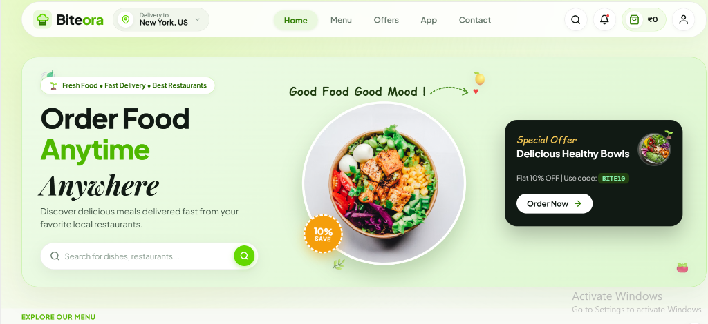
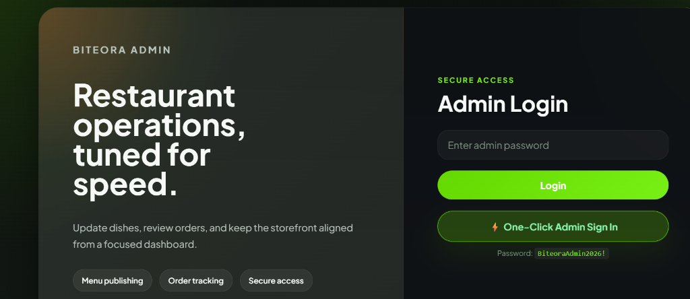

# 🍔 Biteora — Modern Full-Stack Food Ordering & Restaurant Management Platform

[](https://biteora-frontend.vercel.app/)
[](https://biteora-admin.vercel.app/)
[](https://biteorabackend.vercel.app/api/health)
[](https://biteorabackend.vercel.app/api-docs)

### 🚀 Live Production Links
- 🌐 **Customer Storefront:** [https://biteora-frontend.vercel.app/](https://biteora-frontend.vercel.app/)
- 🛠️ **Admin Management Dashboard:** [https://biteora-admin.vercel.app/](https://biteora-admin.vercel.app/) *(One-Click Login or Password: `BiteoraAdmin2026!`)*
- 🔌 **Backend REST API:** [https://biteorabackend.vercel.app/](https://biteorabackend.vercel.app/)
- 📖 **Interactive Swagger / OpenAPI Docs:** [https://biteorabackend.vercel.app/api-docs](https://biteorabackend.vercel.app/api-docs)
- 🩺 **Real-time Health Check:** [https://biteorabackend.vercel.app/api/health](https://biteorabackend.vercel.app/api/health)

A high-performance, industry-level food delivery platform built with the **MERN** stack (MongoDB Atlas, Express 5, React 19, Node.js 24). Biteora features an interactive customer ordering storefront with real-time dish search, responsive category filters, cart management, and order tracking. It includes a dedicated restaurant admin management dashboard with inventory control, real-time KPI metrics, and a secured serverless REST API backend deployed on Vercel with JWT authentication, Stripe checkout integration, and Cloudinary media cloud hosting.

---

## 📸 Application Previews

### Customer Storefront & Catalog


### Restaurant Operations & Admin Portal


---

## 📖 About Biteora

**Biteora** is a contemporary full-stack food ordering and delivery management ecosystem engineered to bridge the gap between hungry food lovers and modern restaurant kitchens. Designed with a clean, mobile-first aesthetic and a lightning-fast cloud backend, Biteora delivers an effortless dining experience from discovery to delivery.

### 🎯 The Vision
Modern food delivery platforms often suffer from cluttered interfaces, sluggish mobile performance, and fragile administrative workflows. Biteora was built from the ground up to solve these challenges through:
- **Intuitive Visual Discovery**: Clean layout inspired by top food applications, featuring instant dish search, dynamic category carousels, diet tags, and live price calculations.
- **Operator-First Control**: A dedicated, real-time administrative suite giving restaurant managers instantaneous oversight into their active prep queue, revenue velocity, and menu catalogs.
- **Enterprise-Grade Security & Privacy**: Server-authoritative price validation, tamper-proof billing calculations, cryptographic webhook verifications, and isolated environment configurations that keep database credentials and secrets strictly private.

### 🌟 Key Pillars

1. **Customer Storefront (`frontend`)**
   - **Hero Discovery Section**: Eye-catching visuals, promotional discount badges (e.g. *BITE10* for 10% off), delivery address switcher, and instantaneous live search across names, ingredients, and categories.
   - **Frictionless Ordering**: Interactive cart drawers, dynamic quantity controllers, and transparent pricing with itemized subtotal, delivery charges, and promo calculations.
   - **Real-Time Order Tracking**: Multi-stage progress indicators (`Order Confirmed` ➔ `Preparing in Kitchen` ➔ `Out for Delivery` ➔ `Delivered`) giving customers complete transparency over their meals.

2. **Restaurant Operations Center (`admin`)**
   - **Live Metric Dashboards**: High-level KPIs tracking Gross Revenue, Total Order Count, Published Menu items, and Average Kitchen Prep Times.
   - **Live Order Pipeline**: Filterable views by order lifecycle stage (*All*, *Processing*, *Out for Delivery*, *Delivered*) with inline status transitions that instantly reflect on customer devices.
   - **Cloud-Synced Menu Management**: Seamless addition and modification of food dishes, powered by Cloudinary streaming for high-definition dish photography.

3. **Cloud-Native Serverless Engine (`backend`)**
   - **Zero Cold-Start Lag**: Intelligent Mongoose connection pooling and lazy reconnection middleware engineered specifically for Vercel serverless execution.
   - **Resilient Fallback Catalog**: High-availability architecture ensuring catalog availability and uptime even during network transitions.
   - **Comprehensive OpenAPI 3.0 Documentation**: Fully documented interactive Swagger specification accessible right from the browser.

---

## ⚡ Engineering Highlights & Features

- 🥗 **Interactive Customer Experience**: Dynamic hero banner with dish search pill, category chips, 10% discount promo badge, and one-click add to cart.
- 📱 **Mobile & Desktop Responsive**: Fully fluid layout optimized across mobile, tablet, laptop, and ultra-wide screens.
- 🛡️ **Server-Side Price Integrity**: All order totals, item prices, and delivery charges are computed strictly using trusted database records from `foodModel`. Client-tampered prices in HTTP payloads are completely rejected.
- 💳 **Cryptographic Stripe Webhooks**: Secure `POST /api/order/webhook` endpoint with HMAC SHA-256 signature verification (`stripe.webhooks.constructEvent`). Customer carts are preserved until payments are confirmed.
- 🔒 **Role-Based Admin Protection**: Endpoints for adding, editing, and deleting menu dishes (`/api/food/add`, `/api/food/:id`) are strictly protected with JWT admin authorization middleware.
- ☁️ **Cloudinary Media Pipeline**: Custom stream upload buffering directly into `mern_stack_project_storage/Biteora`, with tracking of `cloudinaryPublicId` for clean cloud asset deletion.
- 🔍 **Interactive Live Search**: Instant client-side search across dishes, ingredients, and categories on the customer storefront.
- 📊 **Order Pipeline Stepper**: Real-time visual tracking (`Confirmed` ➔ `Preparing` ➔ `Out for Delivery` ➔ `Delivered`) on customer order history.
- 💼 **Admin Management Dashboard**: Real-time KPI summary cards (Revenue, Total Orders, Published Catalog, Avg Prep Time), live order status pipeline, and one-click quick admin login.
- 🩺 **Health Check Diagnostics**: `GET /api/health` providing real-time database connection status, server uptime, and configuration validation.
- 🌐 **Serverless Cold-Start Resilience**: Cached Mongoose connection pooling and auto-reconnect middleware engineered specifically for Vercel serverless execution.
- ⚡ **Universal CORS & Preflight**: Edge trailing-slash normalization and instant `HTTP 204` preflight termination for clean cross-origin requests.

---

## 🛠️ Technology Stack

| Layer | Technologies |
| :--- | :--- |
| **Customer Frontend** | React 19, React Router 7, Vite 7, Axios, CSS Modules |
| **Admin Frontend** | React 19, React Router 7, Vite 7, Axios, react-toastify |
| **Backend API** | Node.js 24+, Express 5, Mongoose 8, JWT, bcryptjs |
| **Database** | MongoDB Atlas Cloud Cluster |
| **Payments** | Stripe Checkout (Test & Live modes) & Webhooks |
| **Media Hosting** | Cloudinary v2 SDK with in-memory streaming |
| **API Documentation**| Swagger UI (`swagger-ui-express`, `swagger-jsdoc`) |
| **Testing** | Node.js Test Runner (`node:test`, `node:assert`) |
| **Deployment** | Vercel Serverless (Backend API, Customer Storefront & Admin Dashboard) |

---

## 📐 Architecture & Monorepo Structure

```
Biteora/
├── frontend/               # Customer-facing React 19 SPA (Vite 7)
│   ├── src/
│   │   ├── Components/     # Navbar, FoodDisplay, Hero, LoginPopup, etc.
│   │   ├── Context/        # StoreContext (cart & food state synchronization)
│   │   └── Pages/          # Home, Cart, PlaceOrder, Verify, MyOrders
│   └── vercel.json         # Vercel SPA routing rewrite
├── admin/                  # Restaurant Admin React 19 SPA (Vite 7)
│   ├── src/
│   │   ├── components/     # Admin Navbar, Sidebar
│   │   └── pages/          # Dashboard (KPIs), Add (dish upload), List, Orders
│   └── vercel.json         # Vercel SPA routing rewrite
├── backend/                # Express 5 REST API (Vercel Serverless Function)
│   ├── api/
│   │   └── index.js        # Serverless entrypoint for Vercel
│   ├── config/             # MongoDB Atlas connection & Cloudinary v2 setup
│   ├── controllers/        # Order, Food, Cart, User, Admin handlers
│   ├── middlewares/        # Standard Bearer auth & Admin auth guards
│   ├── models/             # Schema-first models (User, Food, Order)
│   ├── routes/             # REST endpoints & OpenAPI / Swagger docs
│   ├── test/               # Automated integration test suite (node:test)
│   ├── vercel.json         # Vercel serverless rewrite configuration
│   └── server.js           # Server entrypoint, CORS, webhook stream, health check
├── docs/screenshots/       # Production screenshots for README
├── package.json            # Root monorepo workspace configuration
├── vercel.json             # Root fallback build definition
└── README.md
```

---

## 🧪 Running Automated Tests

Run the backend integration test suite:

```bash
cd backend
npm test
```

Expected output:
```
▶ Biteora API Automated Verification Suite
  ✔ Health check endpoint returns service info with appropriate status code
  ✔ Catalog listing returns dishes array across all categories
  ✔ Unauthenticated menu addition is strictly rejected with HTTP 401
  ✔ Unauthenticated order placement is strictly rejected with HTTP 401
✔ Biteora API Automated Verification Suite (passed)
```

---

## 🚀 Local Development Setup

### 1. Clone & Configure

```bash
git clone https://github.com/Nandhakishore-A/Biteora.git
cd Biteora
```

### 2. Install Dependencies

```bash
cd backend && npm install
cd ../frontend && npm install
cd ../admin && npm install
```

### 3. Start Development Servers

Open three terminals:

```bash
# Terminal 1 - Backend API (http://localhost:4000)
cd backend && npm run dev

# Terminal 2 - Customer App (http://localhost:5173)
cd frontend && npm run dev

# Terminal 3 - Admin Dashboard (http://localhost:5174)
cd admin && npm run dev
```

---

## 🌐 Production Deployment on Vercel

All three applications are continuously deployed on **Vercel** via GitHub integration:

### 1. Backend REST API (`backend/`)
- **Vercel Root Directory:** `backend`
- **Framework Preset:** `Other`
- **Production URL:** [https://biteorabackend.vercel.app/](https://biteorabackend.vercel.app/)
- **Health Check:** [https://biteorabackend.vercel.app/api/health](https://biteorabackend.vercel.app/api/health)

### 2. Customer Frontend (`frontend/`)
- **Vercel Root Directory:** `frontend`
- **Framework Preset:** `Vite`
- **Production URL:** [https://biteora-frontend.vercel.app/](https://biteora-frontend.vercel.app/)

### 3. Admin Management Dashboard (`admin/`)
- **Vercel Root Directory:** `admin`
- **Framework Preset:** `Vite`
- **Production URL:** [https://biteora-admin.vercel.app/](https://biteora-admin.vercel.app/)

---

## 👤 Author & Lead Developer

- **Developer:** [Nandhakishore-A](https://github.com/Nandhakishore-A) (`Nandhakishore-A`)
- **License:** ISC
